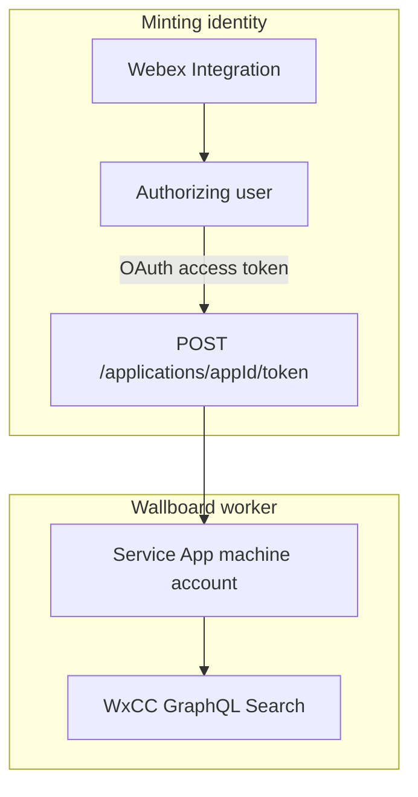

# Use a Webex Integration instead of a PAT

Webex requires a Bearer with scope `spark:applications_token` to call `POST /v1/applications/{appId}/token`. That Bearer is **not** the Service App. It is a second app: either a developer portal PAT (12 hours, no refresh, not for production) or a separate **Integration**.

The wallboard already accepts either in `WEBEX_APPLICATIONS_TOKEN`. After the first successful mint, Search traffic uses the **Service App** access token; that token is refreshed from `apps/api/data/tokens.json`. The Integration/PAT is only needed again if Service App refresh fails (deauthorize, lost `tokens.json`, expired Service App refresh).



Two different Client IDs: [`.env.example`](.env.example) `WEBEX_CLIENT_ID` / `WEBEX_CLIENT_SECRET` / `WEBEX_APP_ID` are the **Service App**. The Integration has its own client id/secret. Do not overwrite the Service App values.

## Why this path exists

- PAT: 12 hours after developer.webex.com login; tied to a person; Cisco says not for production.
- Integration access token: typically 14 days; refresh token typically 90 days (timer resets when used).
- Day-to-day wallboard uptime still depends on **Service App** refresh (also ~14 / 90 days), which [`tokenManager.ts`](apps/api/src/auth/tokenManager.ts) already does.
- The Integration still acts **on behalf of the user who authorized it**. If that user leaves and you later need a remint, you must re-authorize. It is a token-manager identity, not a replacement for the Service App.

Official refs: [Using Webex Service Apps](https://developer.webex.com/docs/service-apps), [Create Service App Access Token](https://developer.webex.com/admin/docs/api/v1/service-apps/create-service-app-access-token), [Integrations](https://developer.webex.com/docs/integrations), [Authentication](https://developer.webex.com/docs/authentication), [Service App Token Management](https://developer.webex.com/blog/service-app-token-management-a-developer-s-guide-to-automation). Scope `spark:applications_token` is not for FedRAMP.

## Steps (current app — no code changes)

Prerequisite: Service App already created (`cjp:config_read`), authorized in Control Hub by a Full Admin, and `WEBEX_CLIENT_ID`, `WEBEX_CLIENT_SECRET`, `WEBEX_APP_ID`, `WEBEX_ORG_ID` set. The Integration is created in the **Service App owner's** Webex developer account (Node4 for partner-hosted, or the customer if they own the Service App). The customer Full Admin still only authorizes the Service App.

1. Sign in to [developer.webex.com](https://developer.webex.com) as the Service App owner.
2. **My Webex Apps** → **Create a New App** → **Create an Integration** (not another Service App).
3. Name/description/icon: something like "WxCC Wallboard token manager". Admins will see this on consent.
4. Redirect URI: a value you control for a one-time callback. Practical options:
   - `http://localhost:3000/callback` (open the authorize URL on a machine; copy `code` from the address bar even if the page fails to load)
   - Postman's `https://oauth.pstmn.io/v1/callback`
5. Scope: **only** `spark:applications_token`.
6. Save. Copy the Integration **Client ID** and **Client Secret** (secret is shown once). Keep these out of git; they are not the Service App credentials.
7. Have a user who may retrieve Service App tokens (typically a Full Admin in the Service App owner org) open:

```
https://webexapis.com/v1/authorize?response_type=code&client_id=INTEGRATION_CLIENT_ID&redirect_uri=URL_ENCODED_REDIRECT_URI&scope=spark:applications_token&state=wallboard
```

8. Approve the consent screen. Copy the `code` query param from the redirect (one-time, short-lived).
9. Exchange the code. These five fields are **form body parameters**, not headers. Only `Content-Type` is a header.

```
POST https://webexapis.com/v1/access_token
Header: Content-Type: application/x-www-form-urlencoded
Body (x-www-form-urlencoded):
  grant_type=authorization_code
  client_id=INTEGRATION_CLIENT_ID
  client_secret=INTEGRATION_CLIENT_SECRET
  code=AUTHORIZATION_CODE
  redirect_uri=EXACT_SAME_REDIRECT_URI
```

```bash
curl --request POST "https://webexapis.com/v1/access_token" \
  --header "Content-Type: application/x-www-form-urlencoded" \
  --data-urlencode "grant_type=authorization_code" \
  --data-urlencode "client_id=INTEGRATION_CLIENT_ID" \
  --data-urlencode "client_secret=INTEGRATION_CLIENT_SECRET" \
  --data-urlencode "code=AUTHORIZATION_CODE" \
  --data-urlencode "redirect_uri=EXACT_SAME_REDIRECT_URI"
```

10. Put the returned `access_token` into `WEBEX_APPLICATIONS_TOKEN`. Store the Integration `refresh_token` somewhere safe **outside** the wallboard for now (password manager / secret store). The app does not read it yet.
11. Start the wallboard with `MOCK_DATA=false`. On first run it mints Service App tokens and writes `apps/api/data/tokens.json`. Confirm `/api/health` and live snapshot data.
12. After a successful mint, the Integration access token can sit unused until remint. If remint happens after that access token expires (~14 days), paste a freshly refreshed Integration access token (step below) or re-run OAuth.

Refresh the Integration token later (manual, until the app does this). Same pattern: **form body**, not headers.

```
POST https://webexapis.com/v1/access_token
Header: Content-Type: application/x-www-form-urlencoded
Body (x-www-form-urlencoded):
  grant_type=refresh_token
  client_id=INTEGRATION_CLIENT_ID
  client_secret=INTEGRATION_CLIENT_SECRET
  refresh_token=INTEGRATION_REFRESH_TOKEN
```

Use the new `access_token` as `WEBEX_APPLICATIONS_TOKEN`. Save any new `refresh_token` Webex returns.

## What the app already does vs a later gap

Already in [`apps/api/src/auth/tokenManager.ts`](apps/api/src/auth/tokenManager.ts):

- Mint with `WEBEX_APPLICATIONS_TOKEN`
- Persist/rotate Service App access + refresh
- Fall back to remint if Service App refresh fails

Not implemented (Cisco's "tier 3"):

- No Integration client id/secret/refresh env vars
- No automatic refresh of `WEBEX_APPLICATIONS_TOKEN`
- No OAuth callback route in the API

For most TV wallboards, a one-time Integration mint plus Service App auto-refresh is enough. Full unattended remint needs those extra env vars and a small TokenManager change.


